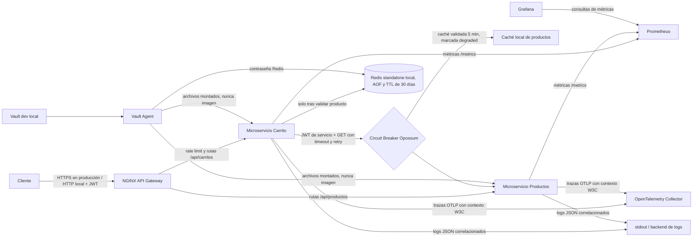

# Arquitectura Cloud-Native — ShopHero

La implementación integra observabilidad, seguridad y resiliencia de forma incremental sobre los servicios Express existentes. En Compose, el puerto `8080` de NGINX es la única entrada publicada al host. Los puertos de carrito, productos, Redis, Prometheus, Grafana, Collector y Vault permanecen en la red interna.

## Flujo integrado

## Seguridad

NGINX centraliza enrutamiento y rate limiting, pero la autenticación no depende solo del Gateway: cada servicio verifica firma HS256, algoritmo permitido, expiración, issuer y audience del JWT. Las rutas requieren scopes específicos y carrito comprueba que el `sub` corresponda al usuario del carrito (salvo un rol `admin`). Carrito firma un JWT de servicio de vida corta para leer productos.

Vault en modo dev y el emisor de tokens local son solo para desarrollo. El bootstrap crea los secretos localmente y los entrega por Vault Agent; Redis también requiere autenticación. Ningún secreto de desarrollo se incluye en el repositorio o en las imágenes. En producción se requiere Vault durable y HA, TLS, un IdP OIDC aprobado, rotación de claves y gestión de identidad de workloads.

## Resiliencia

La validación de producto precede a la escritura en Redis. El cliente usa un timeout acotado, circuit breaker, capacidad máxima por dependencia y reintentos con backoff/jitter únicamente para la consulta HTTP idempotente y errores transitorios. Si falla productos, se usa durante cinco minutos el último producto validado localmente y la respuesta incluye `degraded: true`. Sin una entrada de caché vigente, el endpoint retorna `503` y no modifica Redis. Un `404` de productos retorna `404` sin retry.

El circuit breaker se expone como métrica de estado. El rate limit por IP en NGINX devuelve `429` al exceder la tasa y ráfaga configuradas. La política local falla cerrada para productos desconocidos; la caché degradada no representa una reserva de inventario ni confirma stock disponible.

## Observabilidad

Cada servicio expone latencia por ruta, solicitudes y códigos HTTP, además de métricas del proceso Node. Prometheus scrapea los endpoints internos y Grafana provisiona un dashboard base con p95, tasa de errores 5xx, CPU de proceso y memoria residente. OpenTelemetry instrumenta HTTP, Express y Redis con propagación de contexto W3C y export OTLP al Collector. `pino` produce JSON estructurado con `trace_id`/`span_id`, excluyendo cabeceras de autenticación.

El Collector local usa salida `debug`; no persiste trazas. El backend de logs también es `stdout` hasta que se conecte Loki/ELK. Retención, muestreo y cardinalidad necesitan definición operacional antes de producción.

## Relación con los NFR y alcance

- El dashboard mide p95 frente a los límites de navegación/búsqueda (<300 ms) y carrito/reservas (<500 ms). Esta instrumentación no demuestra esos percentiles bajo carga de 200.000 usuarios.
- La caché y breaker reducen el impacto de caídas de productos, pero no garantizan por sí solos 99,95 % de disponibilidad mensual.
- Se conserva Redis standalone local con AOF y TTL de 30 días, tal como exige el alcance de esta fase. No equivale al Redis Cluster propuesto por ADR-004.
- Reservas de inventario de cinco minutos, Kafka, checkout, PostgreSQL y Outbox son decisiones de arquitectura documentadas, no capacidades implementadas en estos dos servicios.

Consulta [ANALISIS-CRITICO.md](./ANALISIS-CRITICO.md) para los trade-offs y [OWASP-API-SECURITY.md](./OWASP-API-SECURITY.md) para los hallazgos.
