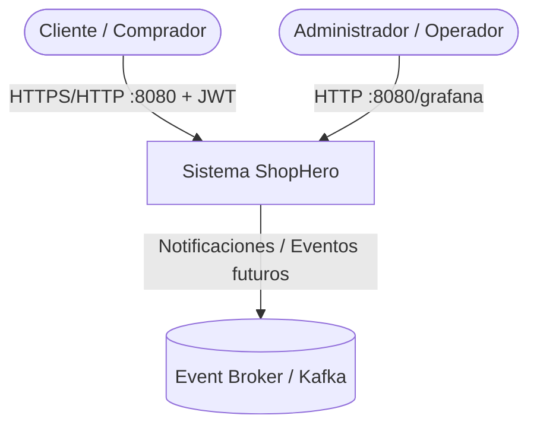

# Dossier Maestro: Arquitectura de Software — ShopHero

Este documento consolida la arquitectura integral de **ShopHero**, estructurada bajo los estándares académicos y profesionales de la materia **Arquitectura de Software** (Modelo C4 / 4+1, Patrones de Arquitectura, Atributos de Calidad - NFRs, Decisiones de Arquitectura - ADRs, Trade-offs y Teorema CAP).

---

## 1. Visión General y Definición del Dominio (DDD - Domain-Driven Design)

- **Nombre del Sistema:** ShopHero Cloud-Native E-Commerce.
- **Tipo de Arquitectura:** Arquitectura Orientada a Microservicios (SOA evolutivo), Event-Driven (con Transactional Outbox) y Persistencia Políglota.
- **Bounded Contexts (Contextos Delimitados):**
  1. **Catálogo de Productos:** Responsable de la definición, precios, categorización e inventario disponible de 14 productos.
  2. **Carrito de Compras:** Responsable de la sesión volátil de compra del cliente, agregación de productos y cálculo preliminar con tolerancia a fallas.
  3. **Gestión de Pedidos (Orders & Checkout):** Responsable de la confirmación atómica de compras, descuento formal de stock, registro de pago y emisión de eventos de dominio.

---

## 2. Vistas de Arquitectura (Modelo C4 / Kruchten 4+1)

### Nivel 1: Diagrama de Contexto del Sistema (System Context)
El usuario interactúa a través de una Single Page Application (SPA) con el ecosistema ShopHero a través de un único punto perimetral.



### Nivel 2: Diagrama de Contenedores (Container Diagram)
Muestra las aplicaciones ejecutables y los almacenes de datos que conforman el sistema.

```mermaid
flowchart LR
    Client[Frontend Web SPA] -->|HTTP :8080 + Bearer JWT| GW[API Gateway NGINX]
    
    subgraph Red de Borde y Aplicación (Docker / K8s)
        GW -->|/api/productos| S_Prod[Microservicio Productos\nNode.js Express :3001]
        GW -->|/api/carritos| S_Cart[Microservicio Carrito\nNode.js Express :3002]
        GW -->|/api/pedidos| S_Order[Microservicio Pedidos\nNode.js Express :3003]
        GW -->|/grafana| Grafana[Grafana Dashboard :3000]
        
        S_Cart -->|Validación síncrona + Circuit Breaker| S_Prod
        S_Cart -->|Persistencia rápida de carritos| DB_Redis[(Redis 7\nIn-Memory + AOF)]
        S_Order -->|Transacciones ACID + Outbox| DB_PG[(PostgreSQL 16\nRelacional)]
        
        VaultAgent[Vault Agent Sidecar] -->|Inyección de secretos en tmpfs| S_Cart
        VaultAgent -->|Inyección de secretos en tmpfs| S_Prod
        VaultAgent -->|Inyección de secretos en tmpfs| S_Order
        VaultAgent -->|Contraseña dinámica| DB_Redis
    end
    
    subgraph Capa de Observabilidad
        S_Prod -.->|Métricas /metrics| Prom[Prometheus 3.2]
        S_Cart -.->|Métricas /metrics| Prom
        S_Order -.->|Métricas /metrics| Prom
        Prom --> Grafana
        S_Cart -.->|Trazas OTLP W3C| OTel[OpenTelemetry Collector]
        S_Prod -.->|Trazas OTLP W3C| OTel
        S_Order -.->|Trazas OTLP W3C| OTel
    end
```

### Nivel 3: Vista de Componentes (Component Diagram - Microservicio Pedidos)
Estructura interna desacoplada en capas (Layered / Hexagonal):
- **Capa de Controladores (app.js):** Validación sintáctica de peticiones HTTP, manejo de códigos de estado REST y enrutamiento.
- **Capa de Autenticación y Autorización (auth.js):** Validación criptográfica de firmas JWT, issuer, audience y scopes requeridos.
- **Capa de Dominio y Persistencia (store.js):** Lógica transaccional de checkout, cálculo de totales, descuento atómico de stock y patrón Transactional Outbox.
- **Capa de Telemetría (telemetry.js & observability.js):** Instrumentación automática de trazas OpenTelemetry y métricas Prometheus.

---

## 3. Patrones de Diseño Arquitectónico Implementados

1. **Patrón API Gateway (BFF - Backend For Frontend):**
   - Centraliza el acceso perimetral.
   - Aplica Rate Limiting (`limit_req_zone` de 10 req/s con burst 20).
   - Oculta la topología interna y la infraestructura de red.
   - Inserta cabeceras de seguridad HTTP (HSTS, CSP, X-Frame-Options, X-Content-Type-Options).

2. **Patrón Circuit Breaker (Opossum):**
   - Evita la degradación en cascada cuando el microservicio de productos se sobrecarga o cae.
   - **Estados:**
     - *Closed (Cerrado):* Flujo nominal; las peticiones van a productos con timeout de 150 ms.
     - *Open (Abierto):* Al superar el umbral de fallos, interrumpe llamadas y activa el fallback de inmediato sin saturar la red.
     - *Half-Open (Medio-abierto):* Envía peticiones de prueba para evaluar la recuperación del servicio.

3. **Patrón Cache-Aside con Degradación Elegante:**
   - El microservicio de carrito mantiene en caché Redis los productos consultados en los últimos 5 minutos.
   - Si el catálogo falla, devuelve el carrito con datos cacheados marcando la respuesta con `_degraded: true` (HTTP 200) en lugar de un error 500.

4. **Patrón Transactional Outbox:**
   - Resuelve el problema del *Dual-Write* (escribir en base de datos y publicar un evento en un broker sin transacciones distribuidas 2PC).
   - En una **única transacción atómica de PostgreSQL**:
     1. Descuenta el stock (`UPDATE productos SET stock = stock - cantidad`).
     2. Inserta el pedido (`INSERT INTO pedidos`).
     3. Inserta los ítems (`INSERT INTO pedido_items`).
     4. Inserta el evento en la tabla `outbox_eventos` (`tipo_evento = 'PedidoConfirmado'`).
   - Un proceso asíncrono (*Message Relay*) lee la tabla outbox y envía los eventos a Kafka/RabbitMQ garantizando entrega *At-Least-Once*.

5. **Patrón Persistencia Políglota (Database-per-Service):**
   - **Redis 7 (Key-Value en RAM con persistencia AOF):** Seleccionado para el carrito por su necesidad de lecturas/escrituras en submilisegundos y ciclo de vida efímero (TTL).
   - **PostgreSQL 16 (Relacional ACID):** Seleccionado para pedidos por la necesidad de integridad transaccional estricta, llaves foráneas y auditoría contable.

6. **Patrón Sidecar & Externalized Secrets Management:**
   - HashiCorp Vault Agent actúa como contenedor sidecar, sincronizando secretos dinámicos en volúmenes compartidos en memoria RAM (`tmpfs`), evitando que las credenciales toquen el disco o se expongan en variables de entorno.

---

## 4. Atributos de Calidad (NFRs - Requerimientos No Funcionales según ISO/IEC 25010)

| Atributo de Calidad | Meta / Escenario Arquitectónico | Mecanismo de Implementación | Resultado Verificado |
|---|---|---|---|
| **Rendimiento (Performance)** | Latencia p95 < 300 ms en navegación; < 500 ms en carrito. | NGINX event-driven, caché en Redis, non-blocking I/O en Node.js. | **p95 de 4.47 ms** en ráfaga de 300 req/s con k6. |
| **Disponibilidad (Availability)** | Mantener el servicio operativo ante caídas de dependencias (SLO 99.95%). | Circuit Breaker (Opossum) + Fallback degradado en caché de Redis. | **100% de éxito en fallback** durante apagado simulado de productos. |
| **Seguridad (Security)** | Zero-Trust interno y mitigación de OWASP API Top 10. | Autenticación JWT con scopes, validación de pertenencia (mitigación BOLA/IDOR), ejecución non-root (`UID 101/70`). | Verificado contra OWASP API1 a API10; NGINX bloqueó 1,950 ataques de saturación con HTTP 429. |
| **Integridad y Consistencia** | Cero sobreventas de inventario y pedidos atómicos. | Bloqueo a nivel de fila y transacciones ACID en PostgreSQL + Outbox pattern. | Verificado: transacciones atómicas; reversión inmediata si falta stock (código HTTP 409). |
| **Mantenibilidad (Maintainability)** | Despliegues independientes sin impacto cruzado. | Microservicios desacoplados con contratos de interfaz REST y pruebas unitarias automáticas. | **35 de 35 pruebas unitarias** pasando en Jest. |
| **Recuperabilidad (Recoverability)** | Recuperación rápida ante pérdida total de datos. | Scripts automatizados de volcado (`pg_dump`, `bgsave`) con rotación a 7 copias. | **Recuperación completa en 2 segundos** tras vaciado catastrófico (`DELETE FROM pedidos`). |

---

## 5. Análisis de Trade-Offs (Compromisos Arquitectónicos) y Teorema CAP

### Aplicación del Teorema CAP (Brewer)
El sistema aplica una estrategia híbrida según el contexto delimitado:
- **Subsistema Carrito + Redis -> Enfoque AP (Availability & Partition Tolerance):**
  - Prioriza la **disponibilidad**. Ante una partición de red con el catálogo de productos, el sistema no bloquea al usuario; responde con datos cacheados (`_degraded: true`) permitiéndole seguir navegando.
- **Subsistema Pedidos + PostgreSQL -> Enfoque CP (Consistency & Partition Tolerance):**
  - Prioriza la **consistencia**. En el momento del checkout final, el sistema exige consistencia transaccional estricta. Si la base de datos o el inventario no pueden garantizar atomicidad, la compra se rechaza (HTTP 409) para evitar sobreventa (*overselling*).

### Matriz de Trade-offs (Compromisos)
1. **Escalabilidad vs. Complejidad Operativa:**
   - *Decisión:* Dividir en 11 contenedores con 3 microservicios.
   - *Ganancia:* Cada microservicio escala horizontalmente según su propia demanda.
   - *Costo:* Exige observabilidad distribuida (OpenTelemetry, Prometheus, Grafana) y orquestación con Docker Compose/Kubernetes.
2. **Desempeño vs. Consistencia Inmediata:**
   - *Decisión:* Caché de 5 minutos en Redis para el carrito.
   - *Ganancia:* Latencias por debajo de 5 milisegundos.
   - *Costo:* Riesgo temporal de que el precio o stock mostrado en el carrito tenga un desfase de unos segundos respecto al inventario real.
3. **Consistencia Transaccional vs. Acoplamiento Distribuido:**
   - *Decisión:* Patrón Transactional Outbox en lugar de Two-Phase Commit (2PC).
   - *Ganancia:* No bloquea hilos de base de datos distribuidas ni requiere coordinadores pesados.
   - *Costo:* Requiere lógica adicional de deserialización de eventos y manejo de idempotencia para posibles eventos duplicados.
4. **Disponibilidad vs. Costo de Infraestructura:**
   - *Decisión:* Redis y PostgreSQL standalone para desarrollo, con manifiestos de Kubernetes preparados para escalado.
   - *Ganancia:* Consumo ligero de recursos en local (~2 GB RAM).
   - *Costo:* Para un ambiente de misión crítica real se requiere migrar a Redis Sentinel y Cloud SQL multi-zona.

---

## 6. Estructura de la Presentación para "Arquitectura de Software"

A continuación se detalla la presentación de 10 diapositivas adaptada específicamente a los criterios de evaluación de un docente de **Arquitectura de Software**:

### Diapositiva 1: Portada y Planteamiento del Problema
- **Título:** ShopHero: Arquitectura de Microservicios Resiliente y Cloud-Native
- **Subtítulo:** Diseño Arquitectónico, Atributos de Calidad y Patrones de Tolerancia a Fallos
- **Guion:** *"Buenos días. Hoy presentamos la arquitectura de software de ShopHero. El reto arquitectónico consistió en diseñar una plataforma de comercio electrónico de alta concurrencia capaz de soportar picos de demanda masivos como Black Friday, eliminando los puntos únicos de falla de los monolitos tradicionales y garantizando atributos clave de calidad como rendimiento, disponibilidad y consistencia de datos."*

### Diapositiva 2: Vista de Contexto y Descomposición del Dominio (DDD)
- **Título:** Descomposición en Bounded Contexts y Persistencia Políglota
- **Puntos clave:** 3 Bounded Contexts autónomos (Catálogo, Carritos, Pedidos). Persistencia adaptada al problema (Redis en RAM vs. PostgreSQL ACID).
- **Guion:** *"Aplicamos diseño guiado por el dominio (DDD), delimitando tres contextos claramente separados. En lugar de una base de datos única para todo, implementamos el patrón Database-per-Service: Redis para el carrito, optimizado para operaciones volátiles de altísima velocidad, y PostgreSQL para el servicio de pedidos, garantizando cumplimiento transaccional ACID."*

### Diapositiva 3: Vista de Contenedores y Topología de Red
- **Título:** Vista C4 de Contenedores y Segregación Zero-Trust
- **Puntos clave:** 11 contenedores. API Gateway perimetral. Redes Docker segregadas (`edge-net`, `app-net`, `data-net`, `obs-net`).
- **Guion:** *"Nuestra vista de contenedores refleja una arquitectura de defensa en profundidad. El API Gateway NGINX es el único componente accesible desde el exterior. Los microservicios y bases de datos residen en redes internas aisladas. De esta manera, si un atacante comprometiera el catálogo, no tendría ruta de red directa hacia la base de datos de pagos o clientes."*

### Diapositiva 4: Patrones de Resiliencia: Circuit Breaker y Degradación Elegante
- **Título:** Patrón Circuit Breaker (Opossum) y Fallback Cache-Aside
- **Puntos clave:** Estados del circuito (Closed, Open, Half-Open). Fallback a caché de 5 minutos en Redis (`_degraded: true`). Prevención de fallas en cascada.
- **Guion:** *"En arquitecturas distribuidas, la latencia y la caída de dependencias son inevitables. Implementamos el patrón Circuit Breaker con la librería Opossum. Si el microservicio de productos experimenta latencia o se apaga, el circuito se abre y el servicio de carrito conmuta de inmediato a una caché local en Redis, devolviendo los datos marcados como degradados. El usuario puede seguir operando su carrito sin percibir una caída del sistema."*

### Diapositiva 5: Consistencia Transaccional: Patrón Transactional Outbox
- **Título:** Consistencia de Datos sin 2PC: Transactional Outbox
- **Puntos clave:** Evita el problema del Dual-Write. Transacción única en PostgreSQL (descuento de stock + inserción de orden + inserción en tabla `outbox_eventos`).
- **Guion:** *"Uno de los mayores desafíos en microservicios es cómo actualizar la base de datos y publicar un evento de dominio sin usar transacciones distribuidas en dos fases (2PC), que son lentas y bloqueantes. Implementamos el patrón Transactional Outbox: dentro de una misma transacción ACID en PostgreSQL descontamos el stock, registramos el pedido y guardamos el evento en la tabla 'outbox_eventos'. Esto garantiza consistencia atómica y prepara el sistema para arquitecturas orientadas a eventos con Kafka."*

### Diapositiva 6: Atributos de Calidad (NFRs) y Verificación con k6
- **Título:** Validación Empírica de Atributos de Calidad
- **Puntos clave:** Prueba de estrés con k6 a 300 req/s. Latencia p95 de 4.47 ms. NGINX Rate Limiting filtrando 1,950 peticiones HTTP 429.
- **Guion:** *"La arquitectura no debe quedarse en diagramas; debe ser verificada empíricamente. Sometimos el sistema a pruebas de carga con k6 enviando 300 peticiones concurrentes por segundo. Los resultados validaron nuestros NFRs: la latencia percentil 95 se mantuvo en apenas 4.47 milisegundos, y el Rate Limiter de NGINX actuó como primera línea de defensa descartando 1,950 peticiones abusivas con código HTTP 429 sin saturar los microservicios internos."*

### Diapositiva 7: Seguridad Arquitectónica: Zero-Trust y OWASP API Security
- **Título:** Seguridad por Diseño (Security by Design)
- **Puntos clave:** Validación criptográfica de JWT en cada nodo. Mitigación de BOLA/IDOR (API1). Gestión de secretos con Vault Agent en `tmpfs`.
- **Guion:** *"La seguridad es un atributo transversal de la arquitectura. Cada microservicio valida independientemente el token JWT, comprobando emisor, audiencia y que el identificador del usuario coincida con el recurso solicitado, mitigando vulnerabilidades críticas como BOLA (Broken Object Level Authorization). Además, eliminamos el hardcoding de credenciales utilizando HashiCorp Vault y Vault Agent, montando secretos dinámicos en memoria RAM volátil."*

### Diapositiva 8: Observabilidad Distribuida: Tríada de Métricas, Trazas y Logs
- **Título:** Observabilidad como Pilar Arquitectónico
- **Puntos clave:** Prometheus para métricas de latencia y saturación. OpenTelemetry Collector para trazas distribuidas W3C (`traceparent`). Grafana para visualización unificada.
- **Guion:** *"Para garantizar la operabilidad de una arquitectura de microservicios, implementamos la tríada de observabilidad. Cada petición HTTP recibe un encabezado de traza distribuida bajo el estándar W3C que viaja entre servicios. Prometheus recolecta métricas en tiempo real cada 5 segundos y Grafana ofrece tableros de control pre-aprovisionados como código para supervisar percentiles de latencia y consumo de recursos."*

### Diapositiva 9: Trade-Offs y Análisis del Teorema CAP
- **Título:** Compromisos Arquitectónicos y Posicionamiento CAP
- **Puntos clave:** Carrito es AP (prioriza disponibilidad con degradación). Pedidos es CP (prioriza consistencia atómica y rechaza compra si no hay stock).
- **Guion:** *"Toda arquitectura es una gestión consciente de compromisos (trade-offs). En términos del Teorema CAP, diseñamos una solución híbrida: el carrito adopta un modelo AP, priorizando la disponibilidad y aceptando consistencia eventual mediante caché. Por el contrario, el servicio de pedidos adopta un modelo CP, priorizando la consistencia transaccional estricta para evitar la sobreventa de productos. Aceptamos una mayor complejidad operativa a cambio de una escalabilidad y resiliencia incomparables frente a un monolito."*

### Diapositiva 10: Conclusiones y Evolución Futura
- **Título:** Conclusiones y Hoja de Ruta Cloud-Native
- **Puntos clave:** 11 contenedores integrados, patrones Cloud-Native probados en vivo, validación de 26 recursos de Kubernetes con Kubeconform.
- **Guion:** *"En conclusión, ShopHero demuestra la aplicación rigurosa de patrones de arquitectura de software para resolver problemas reales de concurrencia, tolerancia a fallos y seguridad. Contamos con 26 recursos de Kubernetes validados con Kubeconform y plantillas de Terraform para desplegar en Google Cloud. La arquitectura está lista para evolucionar hacia clústeres elásticos en la nube. Muchas gracias."*
