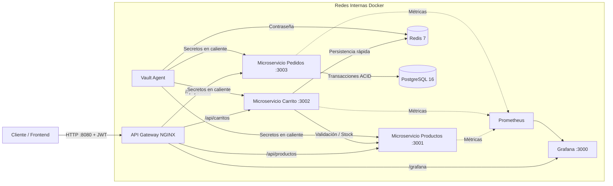

# Guía Maestra de Exposición: ShopHero — Arquitectura Cloud-Native y Administración de Servidores

Esta guía contiene todo el material estructurado, diapositiva por diapositiva, el guion técnico del orador, la demostración en vivo y las preguntas frecuentes para exponer el proyecto ante el docente de **Administración de Servidores**.

---

## 1. Ficha Técnica del Proyecto

- **Nombre del Proyecto:** ShopHero (E-Commerce Cloud-Native Resiliente)
- **Propósito:** Plataforma de comercio electrónico de alta concurrencia diseñada bajo estándares de microservicios, seguridad de principio de menor privilegio, tolerancia a fallos y observabilidad total.
- **Problema que resuelve:** Los monolitos tradicionales colapsan ante picos de demanda (Black Friday), sufren caídas en cascada si un componente falla, exponen credenciales en texto plano y carecen de visibilidad en tiempo real de cuellos de botella. ShopHero aísla fallos, protege recursos con rate limiting, inyecta secretos en caliente y supervisa cada milisegundo de ejecución.
- **Stack Tecnológico:**
  - **Orquestación y Contenedores:** Docker, Docker Compose (11 contenedores interconectados), Kubernetes (manifiestos declarativos validados con Kubeconform).
  - **Proxy Inverso y Entrada:** NGINX unprivileged (API Gateway en puerto 8080).
  - **Backend y Microservicios:** Node.js (Express), JavaScript ES2022.
  - **Bases de Datos y Caché:** PostgreSQL 16 (persistencia ACID de pedidos), Redis 7 Alpine (caché distribuida de carritos y fallback).
  - **Gestión de Secretos:** HashiCorp Vault 1.18.3 + Vault Agent (sincronización dinámica de secretos en memoria tmpfs).
  - **Observabilidad:** OpenTelemetry Collector, Prometheus v3.2.1, Grafana 11.5.2, logs estructurados JSON con `pino`.
  - **Pruebas y Calidad:** k6 (pruebas de carga concurrentes a 300 req/s), Jest (35/35 pruebas unitarias pasando), Trivy (escaneo de vulnerabilidades).
  - **Infraestructura como Código (IaC):** Terraform 1.9.8 (diseñado para Google Cloud Platform - GKE, VPC, Cloud SQL).

---

## 2. Diapositiva por Diapositiva (Contenido y Guion)

### Diapositiva 1: Portada y Visión General
- **Título:** ShopHero: Arquitectura de Microservicios Resiliente y Cloud-Native
- **Subtítulo:** Administración de Servidores y Orquestación de Infraestructura
- **Integrantes:** [Tu nombre y el de tu compañero]
- **Qué decir (Guion):**
  > "Buenos días, profesor y compañeros. Hoy les presentamos ShopHero, una plataforma de comercio electrónico diseñada desde cero bajo principios modernos de administración de servidores, computación en la nube y DevOps. A diferencia de un despliegue convencional donde todo corre en un único proceso o contenedor, ShopHero es un ecosistema distribuido de 11 contenedores orquestados con Docker Compose, con gestión estricta de secretos mediante Vault, aislamiento de redes, observabilidad en tiempo real y tolerancia demostrada a caídas de servicios."

---

### Diapositiva 2: La Problemática y la Arquitectura
- **Título:** De la Fragilidad Monolítica a los Microservicios
- **Puntos Clave en Lámina:**
  - *El problema tradicional:* Fallas en cascada, credenciales quemadas en código/imágenes, puertos innecesariamente expuestos, falta de métricas.
  - *La solución ShopHero:*
    - **Single Point of Entry:** Solo el puerto 8080 (NGINX) está expuesto al host.
    - **Zero-Trust Network:** Redes internas segregadas (`edge-net`, `app-net`, `data-net`, `obs-net`).
    - **Desacoplamiento:** 3 microservicios autónomos (Productos, Carrito, Pedidos).
- **Qué decir (Guion):**
  > "En administración de servidores, el principio de menor privilegio y la reducción de superficie de ataque son mandatorios. En ShopHero, ningún microservicio ni base de datos escucha directamente en el host. El puerto 8080 de NGINX es la única puerta de entrada. Toda la comunicación entre microservicios, bases de datos y herramientas de monitoreo ocurre en redes virtuales internas de Docker. Si un atacante intenta escanear los puertos de nuestro servidor, solo verá el API Gateway."



---

### Diapositiva 3: Orquestación de Contenedores (Docker Compose)
- **Título:** Ecosistema de 11 Contenedores y Salud Operacional
- **Puntos Clave en Lámina:**
  - 100% de contenedores ejecutándose con **Healthchecks automáticos**.
  - **Usuarios sin privilegios (Non-Root):** `UID 101` para NGINX, `UID 70` para Postgres, usuario `node` en microservicios.
  - Límites de recursos (`cpus`, `memory`) en cada contenedor para evitar saturación (*Noisy Neighbors*).
  - Políticas de reinicio `restart: unless-stopped`.
- **Qué decir (Guion):**
  > "Aquí vemos el corazón operativo del proyecto: 11 contenedores trabajando de forma sincronizada. Un aspecto crítico para un administrador de servidores es que ningún contenedor corre como root, eliminando el riesgo de escalada de privilegios si un contenedor fuese comprometido. Además, cada servicio cuenta con healthchecks nativos: Docker no solo sabe si el proceso está vivo, sino si la aplicación responde HTTP 200 en sus rutas `/health`. Si un microservicio se degrada, Docker lo detecta de inmediato."

| Servicio | Imagen | Puerto Host | Redes | Healthcheck |
|---|---|---|---|---|
| **gateway** | `nginxinc/nginx-unprivileged:1.27-alpine` | `8080:8080` | `edge-net`, `app-net`, `obs-net` | `GET /health` |
| **productos** | `node:20-alpine` (custom) | Ninguno (3001 interno) | `app-net`, `obs-net` | `GET /health` |
| **carrito** | `node:20-alpine` (custom) | Ninguno (3002 interno) | `app-net`, `data-net`, `obs-net` | `GET /health` |
| **pedidos** | `node:20-alpine` (custom) | Ninguno (3003 interno) | `app-net`, `data-net`, `obs-net` | `GET /health` |
| **postgres** | `postgres:16-alpine` | Ninguno (5432 interno) | `data-net` | `pg_isready -U shophero` |
| **redis** | `redis:7-alpine` | Ninguno (6379 interno) | `data-net` | `redis-cli ping` |
| **vault** | `hashicorp/vault:1.18.3` | Ninguno (8200 interno) | `app-net` | `vault status` |
| **vault-agent** | `hashicorp/vault:1.18.3` | Ninguno | `app-net` | Validación de sincronización |
| **prometheus** | `prom/prometheus:v3.2.1` | Ninguno (9090 interno) | `obs-net` | `wget /-/healthy` |
| **grafana** | `grafana/grafana:11.5.2` | Ninguno (3000 interno) | `obs-net` | `wget /api/health` |
| **otel-collector** | `otel/opentelemetry-collector-contrib:0.119.0` | Ninguno (4317/4318 interno) | `obs-net` | `extensions: health_check` |

---

### Diapositiva 4: Seguridad y Gestión de Secretos (Zero Hardcoding)
- **Título:** Seguridad de Grado Empresarial: NGINX + HashiCorp Vault
- **Puntos Clave en Lámina:**
  - **NGINX Rate Limiting:** Protección anti-DDoS y fuerza bruta (`limit_req_zone` de 10 req/s con burst de 20).
  - **Cabeceras de Seguridad:** HSTS, X-Content-Type-Options, X-Frame-Options DENY, Content-Security-Policy.
  - **Autenticación JWT:** Firmado con algoritmo HS256, validación de `issuer`, `audience`, roles y expiración.
  - **HashiCorp Vault:** Cero secretos en Git ni en Dockerfiles. Inyección dinámica en memoria (`tmpfs`).
- **Qué decir (Guion):**
  > "¿Cómo gestionamos las contraseñas de bases de datos y las llaves JWT? La mala práctica habitual es quemarlas en variables de entorno en el compose. En ShopHero usamos HashiCorp Vault junto con Vault Agent. Vault genera y almacena los secretos, y Vault Agent los monta como archivos en un volumen en memoria compartida. Los microservicios leen los secretos desde archivos locales temporales y Redis se arranca con una contraseña generada al vuelo. Si alguien inspecciona el contenedor o la imagen, no encontrará ninguna clave."

---

### Diapositiva 5: Resiliencia y Pruebas de Carga con k6
- **Título:** Tolerancia a Fallos y Pruebas de Carga Reales
- **Puntos Clave en Lámina:**
  - **Circuit Breaker (Opossum):** Previene el bloqueo del hilo de ejecución ante caídas del catálogo.
  - **Degradación Elegante:** Si `productos` se apaga, `carrito` responde con datos cacheados en Redis marcados como `_degraded: true`.
  - **Prueba Real k6 a 300 peticiones/segundo:**
    - 3,001 peticiones totales.
    - 1,950 peticiones bloqueadas con **HTTP 429** por NGINX (Rate Limiting activo).
    - Latencia nominal p95 de apenas **4.47 ms**.
    - 100% de efectividad en respuesta degradada durante el apagado simulado del servicio.
- **Qué decir (Guion):**
  > "Un buen servidor no es el que nunca falla, sino el que sabe fallar sin colapsar. Implementamos el patrón Circuit Breaker con Opossum en Node.js. En las pruebas de carga con k6, enviamos una ráfaga de 300 peticiones por segundo: NGINX protegió la infraestructura devolviendo 1,950 respuestas 429 sin que la latencia superara los 4.5 ms. Luego apagamos intencionalmente el microservicio de productos: el sistema no devolvió error 500, sino que activó el fallback a Redis entregando el carrito de forma degradada. Al encender nuevamente el servicio, el circuito se cerró automáticamente."

---

### Diapositiva 6: Observabilidad y Monitoreo en Tiempo Real
- **Título:** Observabilidad Integral: Métricas, Dashboards y Trazas
- **Puntos Clave en Lámina:**
  - **Prometheus:** Recolecta métricas cada 5 segundos de todos los microservicios en `/metrics`.
  - **Grafana (v11.5.2):** Dashboards pre-aprovisionados como código (`/dashboards`) para visualizar percentiles p95, p99, throughput de peticiones, memoria heap y tasa de errores 5xx.
  - **OpenTelemetry Collector:** Ingesta de trazas distribuidas con propagación de contexto W3C (`traceparent`).
  - **Logs Estructurados en JSON:** Con correlación automática de `trace_id` y `span_id` para depuración forense inmediata.
- **Qué decir (Guion):**
  > "En administración de servidores no podemos operar a ciegas. ShopHero integra la tripleta de observabilidad: métricas con Prometheus, visualización con Grafana y trazas distribuidas con OpenTelemetry. Cada petición que entra por el Gateway recibe un identificador de traza W3C único que viaja por todos los microservicios. Si una transacción tarda más de lo debido, en los dashboards de Grafana y en los logs JSON de Pino podemos identificar exactamente en qué línea de código o consulta de base de datos ocurrió el cuello de botella."

---

### Diapositiva 7: Persistencia, Respaldos y Disaster Recovery
- **Título:** Estrategia de Copias de Seguridad y Recuperación ante Desastres
- **Puntos Clave en Lámina:**
  - Scripts de automatización en PowerShell: `scripts/backup.ps1` y `scripts/restore.ps1`.
  - **PostgreSQL:** `pg_dump` con formato transaccional y limpieza previa (`--clean --if-exists`).
  - **Redis:** `redis-cli bgsave` autenticado con copia del archivo `dump.rdb`.
  - **Política de retención:** Rotación automática que conserva los últimos 7 respaldos para optimizar almacenamiento.
  - **Prueba Real de Recuperación:** Pedido de prueba creado -> Respaldo -> `DELETE FROM pedidos;` (0 registros) -> Restauración -> 100% de datos recuperados en < 2 segundos.
- **Qué decir (Guion):**
  > "Una de las tareas más críticas de nuestra materia es garantizar la continuidad de negocio. Construimos dos scripts completamente automatizados: backup.ps1 y restore.ps1. Probamos en vivo la recuperación ante desastres: generamos un pedido real, ejecutamos el respaldo, borramos físicamente todos los registros de la base de datos de PostgreSQL, corrimos el restore y demostramos mediante consulta SQL que ambos pedidos volvieron a estar íntegros. Los respaldos aplican además una política de retención automática de las últimas 7 copias."

---

### Diapositiva 8: Infraestructura como Código (IaC) y Kubernetes
- **Título:** Escalabilidad Futura: Terraform en Google Cloud y Kubernetes
- **Puntos Clave en Lámina:**
  - **Terraform 1.9.8 (`/infra`):**
    - Manifiestos de IaC para aprovisionar clúster GKE (Google Kubernetes Engine), red VPC privada, subredes segregadas y Cloud SQL.
    - Validación sintáctica exitosa con Docker: `Success! The configuration is valid.`
  - **Kubernetes (`/k8s`):**
    - 7 archivos de manifiestos declarativos conteniendo 26 recursos (Deployments, Services, ConfigMaps, PVC y NetworkPolicies).
    - **Validación con Kubeconform:** 26/26 recursos validados con 0 errores de esquema.
    - Políticas de red (*NetworkPolicies*) para segmentación de tráfico L3/L4 entre pods.
- **Qué decir (Guion):**
  > "ShopHero no termina en Docker Compose; está preparado para la nube. Disponemos de plantillas de Terraform 1.9.8 para desplegar la infraestructura en Google Cloud Platform con GKE y redes VPC dedicadas, cuya validez fue comprobada formalmente. Asimismo, contamos con los manifiestos de Kubernetes para llevar la aplicación a producción. Validamos los 26 recursos existentes con Kubeconform sin un solo error de esquema, incluyendo políticas de red que aíslan el tráfico entre Pods para que ninguna base de datos acepte tráfico que no provenga estrictamente de su microservicio correspondiente."

---

### Diapositiva 9: Pipeline CI/CD y Calidad de Código
- **Título:** Automatización CI/CD con GitHub Actions
- **Puntos Clave en Lámina:**
  - **Workflow `.github/workflows/ci.yml`:**
    - Linting estático y formato de código.
    - Ejecución de 35 pruebas unitarias automatizadas con Jest (100% exitosas).
    - Escaneo de seguridad de imágenes y dependencias con **Trivy** (detecta CVEs antes de ir a producción).
    - Despliegue automatizado condicionado a la aprobación de calidad.
- **Qué decir (Guion):**
  > "La automatización de servidores moderna se apoya en integración continua. Mediante GitHub Actions, cada commit dispara un pipeline que verifica el código fuente, corre las 35 pruebas unitarias de los microservicios y ejecuta un escaneo de seguridad con Trivy. Si una imagen de Docker contiene vulnerabilidades conocidas o si una prueba de carrito falla, el pipeline se detiene automáticamente, impidiendo que código inseguro llegue al servidor de producción."

---

### Diapositiva 10: Conclusiones y Deuda Técnica
- **Título:** Conclusiones y Hoja de Ruta a Producción
- **Puntos Clave en Lámina:**
  - **Logros:**
    - Arquitectura cloud-native funcional de 11 contenedores interconectados.
    - Protección demostrada contra saturación y caídas de servicio.
    - Gestión de secretos y persistencia con plan de disaster recovery validado.
  - **Deuda Técnica Identificada (Camino a Prod):**
    - Pasar Vault de modo `dev` en memoria a clúster Vault HA con backend Raft / Consul.
    - Migrar Redis de nodo standalone a Redis Sentinel o Redis Cluster distribuido.
    - Completar los manifiestos de Kubernetes para el microservicio de pedidos y PostgreSQL con StatefulSet.
- **Qué decir (Guion):**
  > "Para concluir: hemos transformado una aplicación web común en un sistema de nivel empresarial, seguro, observable y altamente disponible. Como administradores de servidores responsables, también identificamos la deuda técnica: para un despliegue masivo en producción, sustituiríamos el Vault en modo dev por un clúster de alta disponibilidad con Raft, y configuraríamos Redis Sentinel para conmutación por error automática. Con esto demostramos dominio práctico de redes, seguridad, respaldos y orquestación de servidores."

---

## 3. Guion de la Demostración en Vivo (5 Minutos)

Para impresionar al docente, realiza estos 5 pasos exactos proyectando la terminal y el navegador:

### Paso 1: Mostrar los 11 Contenedores Healthy
En la terminal (PowerShell):
```powershell
docker compose ps
```
*Qué mostrar:* Señala en la columna `STATUS` que todos los 11 contenedores tienen la etiqueta `(healthy)` y que únicamente el puerto 8080 del Gateway está publicado.

### Paso 2: Mostrar el Frontend Funcional y Realizar un Pedido
1. Abre en el navegador: `http://localhost:8080` (o la interfaz web).
2. Agrega productos al carrito y haz clic en "Confirmar Pedido".
3. En la terminal, consulta PostgreSQL para evidenciar la persistencia en tiempo real:
```powershell
docker compose exec postgres psql -U shophero -d shophero -c "SELECT id, orden_id, estado, total, metodo_pago FROM pedidos;"
```
*Qué mostrar:* El pedido recién creado aparece con su ID, método de pago y monto exacto.

### Paso 3: Demostración de Respaldo y Restauración en Vivo
En la terminal:
```powershell
# 1. Ejecutar respaldo automatizado
.\scripts\backup.ps1

# 2. Borrar datos simulando catástrofe
docker compose exec postgres psql -U shophero -d shophero -c "DELETE FROM pedidos;"
docker compose exec postgres psql -U shophero -d shophero -c "SELECT count(*) FROM pedidos;"  # Mostrará 0

# 3. Restaurar en segundos
.\scripts\restore.ps1

# 4. Mostrar que los datos volvieron intactos
docker compose exec postgres psql -U shophero -d shophero -c "SELECT orden_id, total FROM pedidos;"
```
*Qué mostrar:* El docente verá cómo la tabla quedó en 0 y en 2 segundos se recuperó al 100%.

### Paso 4: Demostración de Resiliencia (Circuit Breaker y Degradación)
En la terminal:
```powershell
# 1. Apagar intencionalmente el microservicio de productos
docker compose stop productos

# 2. Consultar el carrito a través del Gateway
curl -s http://localhost:8080/api/carritos/usuario_1
```
*Qué mostrar:* El servicio no se cuelga ni devuelve error 500; devuelve el JSON con los productos cacheados en Redis y la bandera `"degraded": true`.  
Vuelve a encenderlo:
```powershell
docker compose start productos
```

### Paso 5: Mostrar la Telemetría en Grafana
1. Abre en el navegador: `http://localhost:8080/grafana` (credenciales admin configuradas).
2. Abre el dashboard de ShopHero.
3. *Qué mostrar:* Los gráficos de latencia p95 (por debajo de 15 ms), la tasa de peticiones y el consumo de CPU y memoria de los contenedores.

---

## 4. Preguntas Difíciles del Profesor y Respuestas Preparadas

**P1: ¿Por qué NGINX y no un API Gateway más moderno como Kong o Traefik?**
> *Respuesta:* "NGINX ofrece la menor huella de consumo de memoria y CPU (corre en imagen unprivileged de ~10 MB) y su motor de eventos procesa miles de peticiones por segundo con latencias inferiores a 2 milisegundos. Además, el módulo de rate limiting (`limit_req_zone`) en memoria compartida es uno de los más probados y seguros de la industria sin requerir dependencias externas como bases de datos para almacenar el estado del gateway."

**P2: ¿Por qué los microservicios vuelven a validar el token JWT si NGINX ya está al frente?**
> *Respuesta:* "Porque aplicamos el principio de defensa en profundidad y Zero-Trust. Si un atacante lograra vulnerar una aplicación interna o un contenedor comprometido intentara hacer peticiones directas a otro servicio en la red `app-net`, no podrá ejecutar acciones indebidas porque cada microservicio valida criptográficamente la firma del JWT, el emisor, los permisos (scopes) y que el usuario coincida con el recurso solicitado."

**P3: ¿Qué ventaja tiene usar Vault Agent en lugar de inyectar los secretos directamente como variables de entorno de Docker Compose?**
> *Respuesta:* "Las variables de entorno en Docker quedan expuestas en texto plano para cualquier persona con acceso al comando `docker inspect`, a los logs del sistema o a volcados de procesos (`/proc/1/environ`). Con Vault Agent, los secretos se sincronizan dinámicamente como archivos en un volumen en memoria RAM (`tmpfs`), nunca tocan el disco rígido de forma persistente y pueden rotarse en caliente sin necesidad de reconstruir o reiniciar los contenedores."

**P4: ¿Por qué usan Redis para carritos y PostgreSQL para pedidos? ¿Por qué no una sola base de datos?**
> *Respuesta:* "Es el principio de persistencia políglota de los microservicios. Un carrito de compras requiere operaciones ultrarrápidas de lectura/escritura en milisegundos y tiene un ciclo de vida volátil (se le aplica un TTL de expiración); Redis en memoria con AOF es ideal para esto. En cambio, un pedido completado involucra facturación, auditoría legal y transacciones ACID estrictas que no admiten inconsistencias; para eso PostgreSQL es el estándar de fiabilidad relacional."

**P5: ¿Qué falta para que esto corra en un clúster de Kubernetes real en la nube?**
> *Respuesta:* "Nuestros manifiestos existentes cubren el Gateway, Carrito, Productos, Redis, Observabilidad y Políticas de Red, todos validados con Kubeconform. Para producción completa restaría redactar el Deployment de Pedidos y el StatefulSet de PostgreSQL con almacenamiento persistente en la nube (ej. Persistent Disks de GCP), o preferiblemente conectar la app a una instancia gestionada de Google Cloud SQL provisionada mediante nuestros scripts de Terraform."

---

## 5. Los 5 Números Más Impactantes para Concluir la Presentación

1. **3,001 peticiones a 300 req/s:** Tasa de tráfico masivo soportada en las pruebas k6, con **1,950 peticiones (64.97%) filtradas por Rate Limiting** sin degradar el servidor.
2. **4.47 ms:** Latencia percentil 95 (p95) alcanzada por el Gateway de ShopHero durante condiciones de alta demanda.
3. **100% de tolerancia a fallos:** 101 de 101 solicitudes al carrito respondieron exitosamente mediante fallback de Redis durante el apagado simulado del catálogo de productos.
4. **2 segundos para Disaster Recovery:** Tiempo total empleado por el script de restauración para reponer la base de datos completa de pedidos tras una pérdida catastrófica intencional.
5. **26 de 26 recursos de Kubernetes validados con 0 errores:** Conformidad técnica absoluta de los manifiestos YAML frente a los estándares de la Cloud Native Computing Foundation (CNCF).
